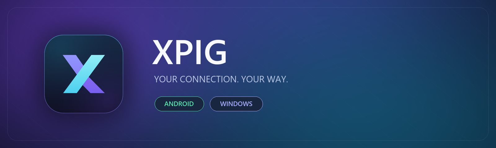

<div align="center">



### 一个账户，连接手机与电脑。

轻松连接 · 自由分流 · 个性外观

[](https://github.com/jtmyd-top/XPIG-Releases/releases/tag/android-v1.2.17)
[](https://github.com/jtmyd-top/XPIG-Releases/releases/tag/windows-v1.1.12)

[下载客户端](#下载客户端) · [功能一览](#功能一览) · [安装与更新](#安装与更新) · [常见问题](#常见问题)

</div>

---

## 下载客户端

选择你的设备，直接下载安装包。两个平台独立维护版本号，请使用对应平台的入口。

| 平台 | 当前版本 | 系统要求 | GitHub 下载 | 备用入口 |
| :--- | :--- | :--- | :--- | :--- |
| **Android 手机 / 平板** | **1.2.17** · 构建 2032 | Android 10 及以上；ARM64 | [**下载 APK →**](https://github.com/jtmyd-top/XPIG-Releases/releases/download/android-v1.2.17/xpig-client-v1.2.17.apk) | [备用 Release 页面](https://github.com/jtmyd-top/XPIG-Releases/releases/tag/android-v1.2.17) |
| **Windows 电脑** | **1.1.12** · 构建 122 | Windows 10 / 11 · x64 | [**下载安装程序 →**](https://github.com/jtmyd-top/XPIG-Releases/releases/download/windows-v1.1.12/xpig-windows-1.1.12-x64-setup.exe) | [备用 Release 页面](https://github.com/jtmyd-top/XPIG-Releases/releases/tag/windows-v1.1.12) |

> **Windows 最低可用版本：1.1.9（119）。** 低于此版本的客户端收到版本策略后，需要升级才能继续使用。

[查看 Android 更新说明](https://github.com/jtmyd-top/XPIG-Releases/releases/tag/android-v1.2.17) · [查看 Windows 更新说明](https://github.com/jtmyd-top/XPIG-Releases/releases/tag/windows-v1.1.12) · [浏览全部发布记录](https://github.com/jtmyd-top/XPIG-Releases/releases)

本次更新：改善连接恢复与智能分流默认体验；Windows 完善 TUN 与局域网共享端口处理，并继续优化暗色连接界面。

## 功能一览

| 连接与节点 | 账户与订阅 | 外观与习惯 |
| :--- | :--- | :--- |
| 节点延迟测试、筛选与排序 | 账户登录与浏览器授权入口 | 浅色、深色极光、跟随系统 |
| 拖拽排列节点，更新订阅保留顺序 | 套餐、订单与钱包页面 | 列表与卡片布局选择 |
| 智能分流、全局代理与直连 | 订阅自动更新与节点恢复 | 节点地区旗帜、大流量单位显示 |
| HTTP / SOCKS5 局域网共享 | 客户端内检查更新 | 本地保存外观及使用偏好 |

## 安装与更新

### Android

> 如果旧版应用内更新出现安装器崩溃或读取权限提示，请先用浏览器下载安装包，直接覆盖安装新版。无需卸载或清除数据。

1. 下载上方 `.apk` 文件，在手机上打开安装。
2. 首次安装时，按系统提示允许当前浏览器或文件管理器安装应用。
3. 打开 XPIG 并登录；首次连接时允许系统 VPN 授权。

已有版本可以直接覆盖安装。请使用本仓库或应用内提供的安装包，以保持签名一致并保留现有数据。

### Windows

1. 下载上方 `x64-setup.exe` 安装程序并运行。
2. 按向导安装，打开 XPIG 并登录。
3. 日常更新可在客户端内完成；新版安装程序支持结束旧进程后进行覆盖更新。

普通更新允许暂时关闭提示；低于最低可用版本时需要升级。正常覆盖更新会保留账户及本地设置。

## 校验下载文件

每个平台的 Release 都附带 `SHA256SUMS.txt`，可用于核对下载完整性。校验值不能代替数字签名。

<details>
<summary><b>展开查看当前版本 SHA-256 与校验方法</b></summary>

**Android 1.2.17**

```text
68ebee4f4f1935447cc233a688a9540566b03e98156fbb6bbd34ba531f7d30eb  xpig-client-v1.2.17.apk
```

**Windows 1.1.12**

```text
cb05fba1f6570efdb035c335cbff63a9a716a938b7ce79243987c7d108be87a4  xpig-windows-1.1.12-x64-setup.exe
```

Windows PowerShell 中，可将文件路径替换为你实际下载的位置：

```powershell
Get-FileHash -Algorithm SHA256 -LiteralPath '.\xpig-windows-1.1.12-x64-setup.exe'
```

[下载 Android 校验文件](https://github.com/jtmyd-top/XPIG-Releases/releases/download/android-v1.2.17/SHA256SUMS.txt) · [下载 Windows 校验文件](https://github.com/jtmyd-top/XPIG-Releases/releases/download/windows-v1.1.12/SHA256SUMS.txt)

</details>

## 常见问题

**为什么手机端与电脑端版本号不同？**

两个平台分别发布和迭代，Android 1.2.17 与 Windows 1.1.12 是各自当前提供的版本。

**GitHub 下载较慢怎么办？**

使用下载表格中的“直连镜像”，文件内容与 GitHub 成品一致。

**应该下载 Assets 中的哪一个文件？**

Android 选择 `.apk`，Windows 选择 `x64-setup.exe`。`Source code (zip / tar.gz)` 是 GitHub 自动生成的仓库快照，里面只有下载说明和品牌图片，不是客户端源码，也不是安装包。

**连接或账户问题在哪里反馈？**

请通过客户端内的工单 / 客服入口反馈，便于核对账户与订单信息。

---

<div align="center">

**XPIG 官方成品发布仓库**<br />
提供安装包、校验文件与更新说明。客户端工程、私有配置、密钥及调试符号不会上传至本仓库。

</div>
